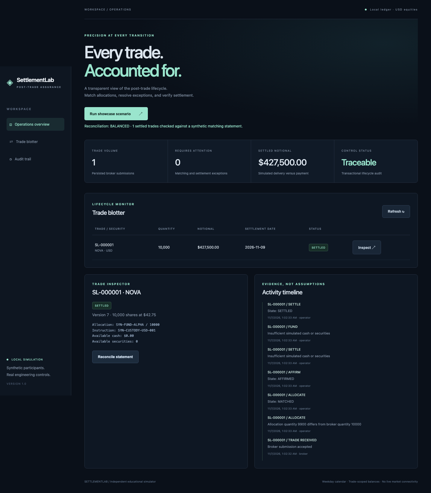
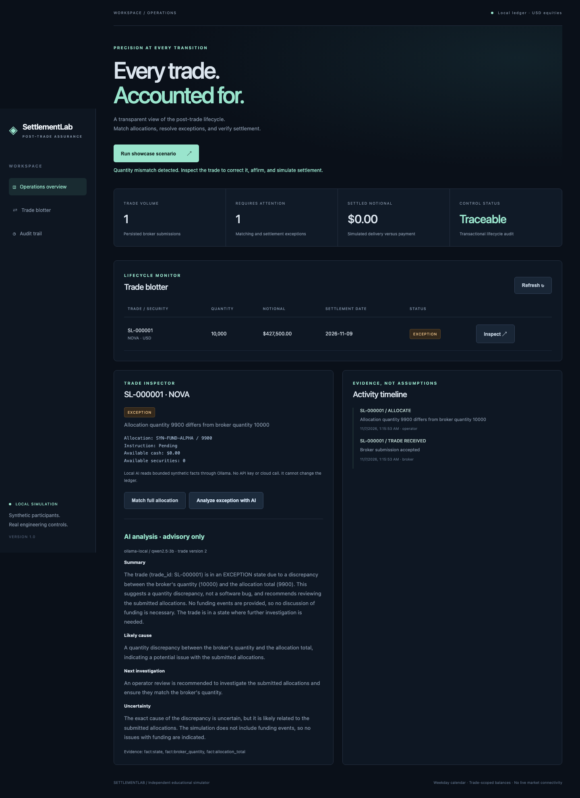

# SettlementLab

**Every trade. Accounted for.**

[](https://github.com/kilicerdal/settlementlab/actions/workflows/assurance.yml)

An independent post-trade simulator and Python assurance framework. Follow a synthetic equity trade from allocation breaks through affirmation, failed settlement, recovery, and reconciliation. The operations console displays live persisted records and their audit history.



## Run locally

Python 3.9+; the application and core tests have **zero third-party dependencies**.

```sh
PYTHONPATH=src python3 -m settlementlab.server
```

Open http://127.0.0.1:8080 and select **Run showcase scenario**. Inspect the exception, match the allocation, affirm instructions, attempt settlement, provision demo balances, retry, and reconcile. The scenario creates a new synthetic trade each time. Data persists in `settlementlab.db`; use `--db /tmp/demo.db` for a separate environment.

Alternatively, install the package with `python3 -m pip install .`, then run `settlementlab`. Static console assets are bundled with the distribution.

## Verify

```sh
PYTHONPATH=src python3 -m unittest discover -s tests -v
```

Optional browser assurance (keep the local server running):

```sh
python3 -m venv .venv
.venv/bin/pip install 'playwright>=1.48,<2'
.venv/bin/python -m playwright install chromium
.venv/bin/python tests/browser_smoke.py
```

Browser evidence is written to `artifacts/desktop.png`, `artifacts/mobile.png`, and `artifacts/journey.zip`. Open the trace with `python -m playwright show-trace artifacts/journey.zip`. CI runs core controls on two Python versions and the full Chromium journey, uploading evidence.

## Engineering controls

- Integer cents and validated decimal inputs; no floating-point settlement calculations.
- Request idempotency with conflicting-payload rejection.
- Optimistic versions prevent stale operator updates.
- SQLite write transactions atomically persist lifecycle changes and audit events.
- A unique settlement record and guarded transitions prevent repeated settlement.
- Concurrency tests exercise competing submissions and settlement attempts.
- Statement reconciliation detects missing records and value mismatches.
- Parameterized SQL and DOM text rendering protect input boundaries.

## AI-assisted exception analysis

The console can request read-only AI triage with evidence citations. AI runs locally through Ollama using `qwen2.5:3b` by default. Start Ollama and run `ollama pull qwen2.5:3b` if needed, then use **Analyze exception with AI**. No API key or paid service is required. Override `SETTLEMENTLAB_MODEL` to select another installed model, or set it to an empty string to disable AI. If the model is unavailable, the console reports the error; it never presents fixtures as live AI. See [AI setup, data boundaries, and evaluation scope](docs/AI.md).



## API example

```sh
curl http://127.0.0.1:8080/api/trades \
  -H 'Content-Type: application/json' -H 'Idempotency-Key: example-001' \
  -d '{"symbol":"NOVA","quantity":100,"price":"42.75","trade_date":"2026-11-06"}'
```

See [API contract](docs/API.md), [architecture](docs/ARCHITECTURE.md), and [showcase guide](docs/SHOWCASE.md).

## Explicit version-one boundaries

This is a local educational simulator with fictional trades, not a trading venue, custodian, or production settlement service. Matching currently checks allocation totals against a broker trade; independent two-sided field matching is a future extension. Settlement is an explicit operator action and is not date-gated. The T+1 date uses weekdays only, without holiday handling. Cash and securities are provisioned per trade, not a participant-level double-entry ledger. Instructions are synthetic references validated by prefix, not a reference-data service. Audit events are transactional but not tamper-proof.

The server binds to loopback and has no login, participant isolation, or approval roles. Do not expose it to a network or use real financial data. Reconciliation compares a supplied statement to internal settlements; the console generates a matching synthetic statement, while the API and tests also exercise breaks. No background queue or external market integration is claimed.

## Recorded showcase evidence

Run `PYTHONPATH=src python3 scripts/capture_showcase.py` to capture seven genuine lifecycle stages and reconciliation in `docs/evidence/settlement-journey.json`. This deterministic capture makes zero model calls.

## Next increments

1. Independent broker/manager submissions and field-level matching rules.
2. Identity, participant authorization, and maker/checker approvals.
3. PostgreSQL, migrations, a shared double-entry ledger, and durable event processing.
4. Reference-data versioning, holiday calendars, and a controlled business clock.
5. Measured performance, accessibility, and broader browser coverage.
