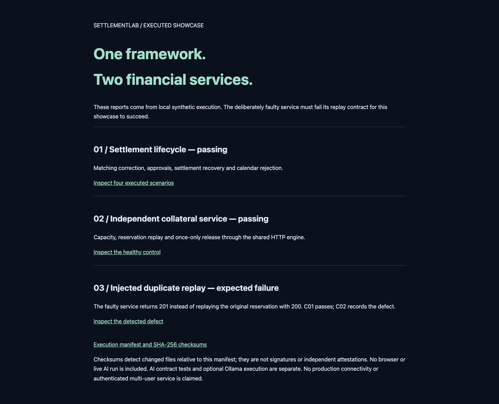

# SettlementLab

**Confidence starts with the match.**

[](https://github.com/kilicerdal/settlementlab/actions/workflows/assurance.yml)

A Python financial systems assurance framework with two runnable reference applications: a post-trade operations workbench and an independent collateral reservation API. Follow a synthetic trade from mismatched submissions through correction, approval, settlement recovery and reconciliation. Then use the same assurance engine to catch a deliberately broken reservation replay.

**V3.0 completes the local showcase release.** Standard-library runtime, reproducible scenarios, exact failure evidence and optional free local AI. Built by Erdal Kilic.

[Website case study](https://www.eai.engineering/engineering/settlementlab) · [Five-minute walkthrough](docs/SHOWCASE.md) · [Architecture](docs/ARCHITECTURE.md) · [Extension guide](docs/FRAMEWORK.md) · [Release history](CHANGELOG.md)


*Generated from executed local scenarios; includes the passing control and expected negative report.*

## Start here

Python 3.9+ and Git. No API key, cloud account, paid service or model runtime is required for the demonstration.

```sh
python3 -m venv .venv
.venv/bin/python -m pip install .
.venv/bin/python -m scripts.showcase
.venv/bin/python -m scripts.showcase --verify
```

Run from the repository root. Open `artifacts/showcase/index.html` in a browser. The command starts temporary loopback services with temporary databases, runs the scenarios, closes them and writes portable evidence:

| Report | Required result | What it demonstrates |
|---|---|---|
| Settlement | Four passing scenarios | Matching, approval, capacity recovery and calendar rejection |
| Collateral control | Two passing scenarios | Independent service, capacity, reservation replay and release |
| Collateral injected fault | C01 passes; C02 fails with expected 200 / observed 201 | The engine detects the specific replay defect |

A successful showcase includes an explicitly **failed negative report**. An arbitrary service failure does not count as defect detection. The manifest records framework/Python version, source commit and dirty state, plus checksums for all generated reports. Verification checks files and exact report outcomes; checksums are not a signature or independent attestation. This command does not run the full control suite, browser or live AI.

## Explore the operations console

```sh
.venv/bin/settlementlab --config environments/showcase.json
```

Open http://127.0.0.1:8085. The profile visibly fixes the simulated business date to **2026-11-09**. Audit timestamps remain real. Default startup without this profile uses the actual UTC date.

1. Select **Run showcase scenario** and inspect the independent price and allocation-total breaks.
2. Revise manager price to `42.75`, allocations to `SYN-FUND-ALPHA,6000` and `SYN-FUND-BETA,4000`.
3. As Alex · Maker, request instruction approval; switch to Sam · Checker and approve.
4. Attempt settlement, inspect insufficient capacity, fund shared shortfalls and retry.
5. Inspect the four balanced journal lines and reconcile the statement.

The database persists at `artifacts/showcase.db`. For a fresh isolated demonstration, pass `--db /tmp/settlementlab-new-demo.db` with an unused filename. [Detailed walkthrough and presentation script](docs/SHOWCASE.md).

## What the framework proves

| Area | Implemented control | Evidence |
|---|---|---|
| Matching | Separate broker/manager terms, seven exact fields, allocation totals, preserved revisions | Catalog S01; matching unit/API tests |
| Approval | Maker request, separate checker identity, stale-version rejection | S02; role, revision and approval tests |
| Settlement | Shared participant cash/securities, exact cents, atomic four-line postings, idempotency | Lifecycle, rollback and concurrent-spending tests |
| Calendar | Pinned policy/fingerprint, next-business-day rule, early/closed-day rejection | S03/S04; calendar tests |
| Reconciliation | Missing/external records and amount/status discrepancies | Reconciliation tests |
| Reuse | Generic JSON HTTP transport, target profiles, response references, unique run keys | C01/C02 against independent SQLite service |
| Reporting | JSON, HTML, JUnit, structured expected/actual failures, nonzero exit | Negative runner/report tests; controlled fault CI |
| Local AI | Bounded facts, structured output, cited evidence, advisory authority | Injected contract tests; separately recorded Ollama examples |

## Architecture

```text
src/settlementlab/
  core/             Pure financial policies and invariants
  application/      Workflow orchestration and persistence ports
  infrastructure/   SQLite transactions, migrations, journal and demo sessions
  adapters/         HTTP console/API and loopback Ollama transport
  assurance/        Shared client, fixtures, profiles, scenarios and reports
examples/
  collateral_service/  Independent API; no framework imports
scripts/showcase.py     Orchestrates both applications and verifies evidence
 tests/                Unit / integration / API / browser
```

Application composition is explicit in `bootstrap.py`. The assurance engine uses the same HTTP/reporting primitives for both services; financial helpers extend the generic client. The second reference app is source-only, while its scenarios ship in the wheel. [Reuse contract and target setup](docs/REUSE.md).

## Verify and extend

```sh
.venv/bin/python -m pip install -r requirements-quality.txt
.venv/bin/ruff check src tests scripts examples
.venv/bin/ruff format --check src tests scripts examples
.venv/bin/mypy
.venv/bin/coverage run -m settlementlab.assurance.runner --suite all --root .
.venv/bin/coverage report
```

CI runs Python 3.9/3.13 controls, installed-package checks, Chromium, separate-process collateral controls and portable showcase verification. Coverage has an 85% combined statement/branch minimum. Strict typing covers the pure core and configuration; other layers are not fully typed. [Quality scope](docs/QUALITY.md) · [Contributing](CONTRIBUTING.md).

Run `.venv/bin/settlementlab-assure --suite scenarios` for shipped financial scenarios outside the checkout. Full suites require source/tests. Reports default to `artifacts/reports/`. Browser automation requires the optional Playwright tooling and a running showcase server; [commands and evidence scope](docs/SHOWCASE.md#browser-and-ai-verification).

## Free local AI

With Ollama and `qwen2.5:3b` already installed locally, select **Analyze exception with AI**. No API key or paid inference service is used. The model receives bounded synthetic facts and must cite supplied evidence. It cannot approve, fund or settle. Unavailable models return an error; there is no fake response fallback.

Local inference consumes your machine's resources. Contract tests use injected responses; recorded/live model examples are separate and are not an accuracy benchmark. [Setup, data boundaries and evaluation](docs/AI.md).

## Scope and limitations

This is a synthetic local simulation and assurance showcase. Demo personas are openly switchable; role checks do not authenticate distinct humans or isolate participant data. APIs bind to loopback and are not intended for public hosting. No real money, securities or external market connection is involved.

Financial scope is USD equity trades with exact cent prices and bounded integer balances. Calendars use weekdays plus explicit project closures, not an official exchange dataset or intraday cutoffs. Trades pin their calendar; policy changes do not rewrite them. Journal and revision history are transactional, not tamper-proof. Production identity, distributed processing, load certification and broad model evaluation remain outside V3.0.

Existing databases migrate additively: back up first. Legacy allocation-only and trade-scoped contracts remain supported; new console trades use two-sided matching and shared-ledger controls. [API contract](docs/API.md) · [Matching policy](docs/MATCHING.md).

## License

[MIT](LICENSE) — copyright 2026 Erdal Kilic.
