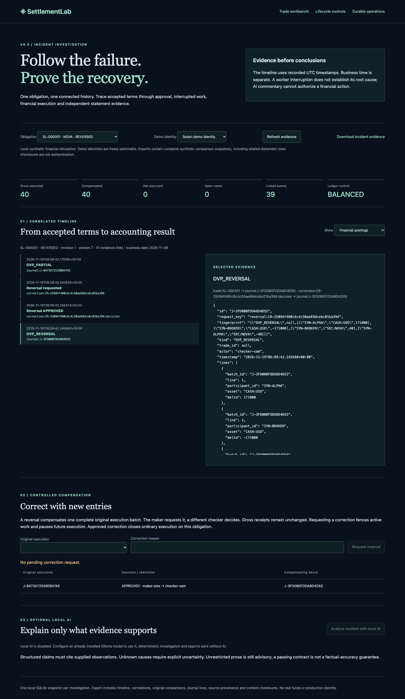

# SettlementLab

[](https://github.com/kilicerdal/settlementlab/actions/workflows/assurance.yml) [](https://github.com/kilicerdal/settlementlab/releases/tag/v4.3.0)  [](LICENSE)

**Financial workflows. Reusable assurance. Inspectable evidence.**

SettlementLab is a Python financial systems assurance framework with two runnable reference applications: a post-trade operations workbench and an independent collateral reservation API. Follow a synthetic obligation through matching, independent approval, partial settlement, recovery and reconciliation. Then install the assurance engine separately and use it to detect a deliberately broken reservation replay.

**V4.3 is the current release.** Standard-library runtime, no required API key or paid service, and optional local AI. Built by Erdal Kilic.

[Download V4.3](https://github.com/kilicerdal/settlementlab/releases/tag/v4.3.0) · [Reviewer guide](docs/REVIEWER_GUIDE.md) · [V4.3 incident and API guide](docs/V4_3.md) · [Architecture](docs/ARCHITECTURE.md)


*Recorded synthetic V4.3 browser journey. The screenshot illustrates the local interface; it is not a live CI result.*

## V4.3 — incident investigation and controlled compensation

V4.3 connects a real worker interruption, partial execution, delayed statement, investigation and maker/checker compensation in one replayable incident. A new local investigation screen links the complete evidence; portable exports retain original comparisons, financial entries and checksums. An isolated reviewer exercise includes a balanced but economically incorrect compensation. Optional local AI is evaluated against declared adversarial fixtures and separately recorded live samples.

```sh
python3 scripts/incident_quickstart.py
# Local investigation: http://127.0.0.1:8086/investigation
```

Standard-library runtime; no package install or model is required for the checkout demonstration. The command creates fresh evidence, runs the recovery and starts the local server. [V4.3 incident guide](docs/V4_3.md) · [AI evaluation and retained samples](docs/V4_3_AI.md) · [Recovery runbook](docs/runbooks/INCIDENT_RECOVERY.md). V4.3 is the current release; independent human review remains pending. The portfolio website is unchanged.

## Core framework capabilities

| Capability | Implemented behavior |
| --- | --- |
| Versioned obligations | Maker amendments preserve accepted terms, invalidate stale approvals and matching authority, and fence active workers. Replacement terms require fresh matching and approval. |
| Partial settlement | Explicit execution quantities produce balanced cash/securities postings, retained slices and cumulative receipts. Cancellation closes only the remaining obligation. |
| Deadlines and aging | New obligations pin a project-defined UTC cutoff; explicit timestamp simulations enforce it. Business-day aging identifies overdue work. |
| Reconciliation investigations | Independently imported CSV statements produce classified discrepancy cases. Resolution requires corrected numeric evidence and retains the original comparison. |
| Durable recovery | Financial posting, processing receipt and outbox commit together. Leases, fencing, retries and observer deduplication handle interrupted work and uncertain delivery. |
| Framework reuse | A separate HTTP assurance wheel runs declarative scenarios against another service without installing the financial application. |

**Scope:** synthetic USD equity obligations, simulated balances and freely switchable demo personas. No real funds, market connection or production identity. [Detailed boundaries](#scope-and-limitations).

## Run the workbench

Python 3.9+ and Git are required. These commands use a virtual environment on macOS/Linux:

```sh
git clone https://github.com/kilicerdal/settlementlab.git
cd settlementlab
python3 -m venv .venv
.venv/bin/python -m pip install .
.venv/bin/settlementlab --config environments/showcase.json --model ''
```

Open the [trade workbench](http://127.0.0.1:8085), [V4.2 lifecycle controls](http://127.0.0.1:8085/lifecycle) or [durable operations](http://127.0.0.1:8085/operations). The profile uses business date **2026-11-09** and persists its synthetic database at `artifacts/showcase.db`. Audit and queue timestamps remain real. This date-only profile does not enforce an intraday cutoff; see [timestamp simulation](docs/V4_2.md#try-locally).

Start with **Run showcase scenario** in the trade workbench. Correct the manager terms, request approval as the maker, switch to the checker and approve. Fund shared shortfalls, then inspect partial execution, remaining obligations and imported statement evidence in the lifecycle screen. [Guided demonstration](docs/SHOWCASE.md) · [V4.2 command reference](docs/V4_2.md).

For installation without a checkout, download either wheel from the [V4.3 release](https://github.com/kilicerdal/settlementlab/releases/tag/v4.3.0). The release includes CI evidence, provenance and SHA-256 checksums. The financial workbench wheel is `settlementlab-4.3.0-py3-none-any.whl`; the independent engine is `settlementlab_assurance-4.3.0-py3-none-any.whl`.

## Review the evidence

The V4.3 release passed **184 unit/API/integration tests and four assurance scenarios**, with Python 3.9/3.13 controls and all nine CI jobs passing. Evidence also includes:

- Existing trade, durable operations and V4.2 browser journeys, including a mobile viewport.
- Nine targeted source mutants detected by real tests; invalid mutants are not counted as detections.
- An independent slice oracle that rejects balanced but economically incorrect postings.
- A genuine populated V4.1 database upgrade, expired-claim recovery, downgrade refusal and backup restoration checks.
- A 1,000-trade/four-worker local campaign with 1,000 execution slices, receipts and outbox records, plus 8,000 journal lines.
- A clean standalone-wheel installation that passes the healthy second service and detects its injected replay defect.

These are release-specific results, not a promise of production capacity. The status badge links to current CI. **Independent human review remains pending.** [Validation details](docs/V4_2_EVIDENCE.md) · [Review checklist](docs/INDEPENDENT_REVIEW.md) · [Evidence provenance](docs/EVIDENCE.md).

From the repository root, generate a portable demonstration of both applications:

```sh
.venv/bin/python -m scripts.showcase
.venv/bin/python -m scripts.showcase --verify
```

Open `artifacts/showcase/index.html`. Success includes an intentionally failed negative report: the collateral replay must return observed `201` where the contract expects `200`. An arbitrary service failure does not count as defect detection. The manifest records source/version information and report checksums; it is not an independent attestation.

Run the full controls and V4.2 evidence checks with:

```sh
.venv/bin/python -m pip install -r requirements-quality.txt 'setuptools>=68' wheel
.venv/bin/coverage run -m settlementlab.assurance.runner --suite all --root .
.venv/bin/coverage report
.venv/bin/python -m scripts.mutation_campaign
.venv/bin/python -m scripts.v42_compatibility
.venv/bin/python -m scripts.v42_workload --trades 1000
.venv/bin/python -m scripts.build_assurance
.venv/bin/python -m scripts.verify_assurance_package
```

The compatibility rehearsal requires the `v4.1.0` Git tag. Full suites require the source/tests; browser checks additionally require Playwright. CI enforces an 85% combined statement/branch coverage minimum, lint, formatting and typing within the documented scope. [Quality commands and coverage](docs/QUALITY.md) · [Recovery runbooks](docs/runbooks/LIFECYCLE_RECOVERY.md) · [Upgrade compatibility](docs/runbooks/RELEASE_COMPATIBILITY.md).

## Use the assurance engine with your own API

Install the standalone wheel from the release in your service's virtual environment. It has no runtime dependencies and does not require the financial application. Point it at an API you own and supply a declarative JSON scenario pack:

```sh
settlementlab-http-assure --target owned-api --base-url http://127.0.0.1:8091 \
  --scenario-dir your-pack/ --report-dir artifacts/my-service
```

The engine supports bounded HTTP steps, exact JSON assertions, response references, unique run keys and portable HTML/JSON/JUnit reports. Scenario packs execute no arbitrary Python. [Standalone framework](docs/STANDALONE_ASSURANCE.md) · [Second-service tutorial](docs/SECOND_SERVICE_TUTORIAL.md) · [External scenario contract](docs/EXTERNAL_SCENARIOS.md).

## Architecture and engineering decisions

```text
src/settlementlab/
  core/             Financial policies, validation and invariants
  application/      Workflow orchestration and persistence ports
  infrastructure/   SQLite transactions, migrations, journal and evidence
  adapters/         Local HTTP workbench/API and Ollama transport
  assurance/        Generic HTTP engine, financial fixtures and reporting
examples/
  collateral_service/  Independent reference API
scripts/               Reproducible demonstrations and evidence campaigns
tests/                 Unit, integration, API and browser controls
```

Composition is explicit in `bootstrap.py`. Financial workflows use application ports; SQL stays in infrastructure. The standalone build packages an allowlist of canonical generic assurance modules into the distinct `settlementlab_assurance` namespace. Both wheels can coexist without file ownership collisions.

[Architecture](docs/ARCHITECTURE.md) · [Engineering decisions](docs/decisions/README.md) · [Versioned obligation design](docs/decisions/006-versioned-obligations.md) · [Extension guide](docs/FRAMEWORK.md).

## Optional local AI

With Ollama and `qwen2.5:3b` installed locally, start the workbench without `--model ''` and select **Analyze exception with AI**. No API key or paid inference service is required. The model receives bounded synthetic facts and must cite supplied evidence; it cannot approve, fund, settle or resolve numeric discrepancies.

Unavailable models return an error rather than a fabricated response. Contract tests use injected responses; recorded/live model examples are separate and are not an accuracy benchmark. Local inference consumes your machine's resources. [AI setup and boundaries](docs/AI.md) · [Evaluation and review](docs/AI_REVIEW_V4_1.md).

## Scope and limitations

This is a local simulation and engineering portfolio framework. Demo role checks do not authenticate distinct humans or isolate participant data. APIs bind to loopback and are not intended for public hosting. Independent human review, production identity, distributed processing, load certification and broad model evaluation remain outside the demonstrated scope.

Financial calculations use exact cents and bounded integer balances. Calendars use weekdays and explicit project closures; timed clocks apply the pinned project-defined UTC cutoff. These are not official market calendars or jurisdictional settlement rules. Date-only simulations do not infer an intraday time, and migrated V4.1 trades do not acquire a retroactive cutoff.

One SQLite database serializes writers. Workload results are bounded local measurements, not scaling guarantees. Journal, revision and statement evidence is retained transactionally, not made tamper-proof. Imported statements are user supplied, not authenticated counterparty feeds. Posted terms cannot be amended. V4.3 provides separately authorized full-batch compensation as documented above.

Schema 7 upgrades are additive and transactional. Back up and verify restoration before upgrading. V4.2 refuses the newer schema; rollback requires the pre-upgrade backup. Legacy allocation-only and trade-scoped contracts remain supported. [Upgrade and recovery guidance](docs/runbooks/RELEASE_COMPATIBILITY.md).

## Earlier releases and walkthroughs

| Release | Supporting material |
| --- | --- |
| V4.2 | [Versioned obligations, partial settlement and statement investigation](docs/V4_2.md) |
| V4.1 | [Independent financial assurance, generated invariants and reviewer scorecard](docs/V4_1_ASSURANCE.md) |
| V4.0 | [Durable operations, process crashes and outbox recovery](docs/DURABLE_OPERATIONS.md) |
| V3.0 | [Captioned video](https://github.com/kilicerdal/settlementlab/releases/download/v3.0.0/settlementlab-walkthrough.webm), [presentation guide](docs/SHOWCASE.md) and [recorded screenshot](docs/images/showcase-v30.png) |

Historical recordings illustrate their named versions; they are not V4.2 walkthroughs or current CI evidence. [Release history](CHANGELOG.md) · [Website case study](https://www.eai.engineering/engineering/settlementlab).

## Contributing and maintenance

[Contributing](CONTRIBUTING.md) · [Security reporting](SECURITY.md) · [Dependency policy](docs/DEPENDENCY_MAINTENANCE.md) · [Compatibility and maintenance](docs/MAINTENANCE.md).

[MIT license](LICENSE) — copyright 2026 Erdal Kilic.
