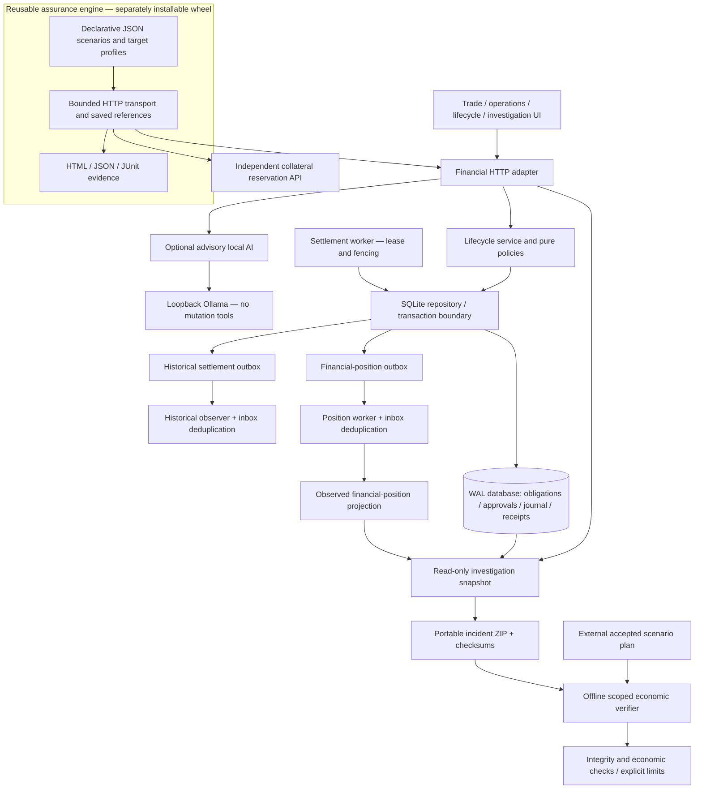

# Architecture and decisions

SettlementLab V4.4 combines a reusable HTTP assurance engine with two reference applications. The financial workbench demonstrates durable execution and controlled correction; the collateral service demonstrates that assurance can be reused without installing the financial application. Both use synthetic data.

Arrows describe commands and data flow, not independent services. Outboxes, inbox receipts and projections are tables in the same local database. Worker CLIs can run in separate processes. The collateral reference application owns its own database and has no framework imports.

## Execution and recovery

`bootstrap.py` composes explicit settings, application services, infrastructure adapters and optional AI. Core matching, identity rules and calendar policies are independent of HTTP. Application services use the store/repository ports; SQLite adapters own SQL and migration.

A settlement worker claims queued work with an expiring lease. Fencing and obligation-version checks reject stale authority. One write transaction commits financial entries, execution slice, processing receipt, lifecycle state and outgoing events. `BEGIN IMMEDIATE` serializes local writers. A process interrupted after claim leaves retained evidence; another worker can recover after lease expiry. Retry and duplicate-delivery controls do not imply distributed exactly-once execution.

Partial execution posts four cash/security legs per slice. Monetary amounts use bounded integer cents; quantities and per-asset balance checks are explicit. Approving a compensation appends exact inverse entries and retains the original receipt. Gross execution, reversed execution and current net position remain distinguishable. Compensation closes the remaining ordinary execution path; net zero does not mean the obligation never executed.

## Two observer meanings

The historical outbox records that execution happened. Its delivered `PARTIALLY_SETTLED` receipt stays historical even after compensation.

The financial-position outbox carries versioned net effects, including compensation. Its worker maintains a separate observed projection. Authoritative values can therefore be current while observation is `LAGGING`. Inbox receipts deduplicate delivery; an old event cannot regress a newer projection. See [position and verification recovery](runbooks/POSITION_AND_VERIFICATION.md).

## Consistent reads and portable verification

Read-only SQLite transactions provide a consistent WAL snapshot without taking the writer reservation. Investigations correlate worker attempts, approvals, execution slices, statements, compensation and position events. Retrieval is indexed and bounded; exceeding the investigation bound fails explicitly rather than silently dropping history. Global journal validation still scans retained financial history.

Exports contain the snapshot, HTML view and checksum manifest. Checksums establish internal content integrity, not authenticity. An offline verifier can additionally compare exact participants, assets, signs, quantities and cents with a separately supplied accepted plan. Without that plan, economic verification is explicitly `NOT_RUN`. The showcase uses a separate process and declared scenario inputs; this is not an independent human attestation. See [V4.4](V4_4.md).

## Approval, time and reconciliation

Maker/checker commands require different resolved demo principals. Session tokens expire; request JSON cannot assign its own role. Anyone at the local console can switch personas, so this demonstrates command authorization rules rather than production authentication or distinct-person verification. Reads are not isolated by participant.

Versioned amendments retain accepted terms and invalidate stale approvals, matching authority and worker claims. Project calendar and cutoff policies are pinned to obligations. Explicit timestamp simulation enforces the UTC cutoff; the date-only showcase profile does not enforce intraday time. Audit timestamps remain real. Official market-calendar datasets are outside scope.

Legacy `/api/reconcile` compares gross receipts. The statement-import investigation contract compares net-after-compensation positions and retains original discrepancy snapshots and later resolutions. A corrected statement, rather than a changed label, is needed to resolve a case.

## AI and reusable assurance

The optional loopback AI adapter receives bounded, versioned evidence and returns schema-constrained advisory text with references. It cannot mutate financial state. Analysis runs outside the transaction and may become stale; citation and schema validation do not prove semantic accuracy. Deterministic fixtures and retained live samples are reported separately. The recorded walkthrough does not invoke a model.

The independently installable assurance engine owns transport, allowlisted scenario actions, saved JSON references and report exporters. The collateral example's healthy replay must return `200`; its intentionally faulty variant returns `201`. Only that exact violated contract counts as the expected defect detection. The failed negative report is retained as evidence. See [standalone assurance](STANDALONE_ASSURANCE.md) and [framework extension](FRAMEWORK.md).

## Tradeoffs and boundaries

SQLite, a standard-library runtime and local profiles keep the demonstration free and reproducible. Single-writer serialization, full journal scans, bounded investigation and a project-defined calendar favor inspection over market-scale throughput. Direct database access can alter evidence. There is no real money, production identity, market connection, external custody, distributed deployment guarantee or independent human review claim.

Read the [engineering decision records](decisions/README.md) for alternatives and implementation references. Older trade-scoped contracts and allocation-only transitions remain compatibility paths; they should not be presented as the current shared-ledger governance model.
