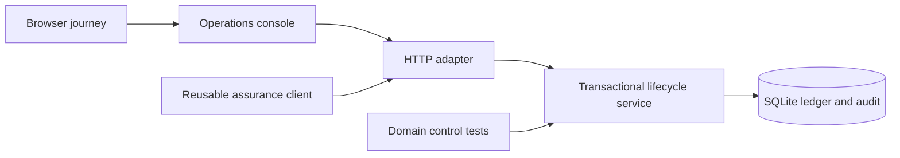

# Architecture and decisions

The domain service has no dependency on the HTTP server or UI. Each command opens a short write transaction, reads the current version and state, validates its preconditions, updates the trade, and appends an audit event. A failed command rolls back the entire transaction. BEGIN IMMEDIATE serializes competing writers in this local implementation. The settlement table has one record per trade.

## State machine

RECEIVED → MATCHED or EXCEPTION on allocation. EXCEPTION may be corrected to MATCHED. MATCHED → AFFIRMED when a synthetic instruction is supplied. AFFIRMED → SETTLED or FAILED on attempted settlement. FAILED may be funded and retried. SETTLED is terminal. Funding updates balances without changing lifecycle state. All successful commands increment the version.

## Deliberate choices

SQLite and Python's standard library make the first release inspectable and reproducible without infrastructure provisioning. This limits deployment scale and HTTP hardening. No distributed-system guarantees are implied. Business stages remain explicit so they can evolve behind the same conceptual command boundaries.

The current service supports positive fixed-point USD prices with two decimal places. Products requiring more precision need a versioned numeric policy. The weekday-only calendar is explicit rather than pretending to represent market holidays.

## Assurance strategy

Domain tests exercise arithmetic, validation, lifecycle guards, persistence, rollback, idempotency, reconciliation, and concurrency. HTTP tests use a real ephemeral TCP server and temporary database. The browser journey exercises the persisted system through the console and captures desktop/mobile screenshots plus a trace. Expected settlement amounts in tests are independent constants.
