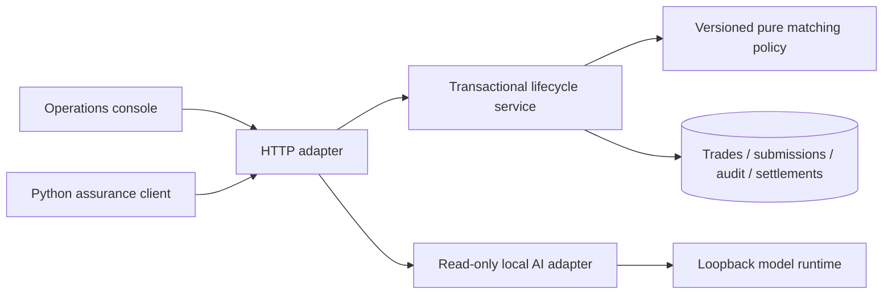

# Architecture and decisions — V3.0

## Transaction boundaries

The lifecycle service requests transactions through an application-owned store port and has no SQL, HTTP or UI dependency. SQLiteStore implements the transaction boundary. Shared validators define exact monetary constraints. The matching module normalizes independent terms and compares them without storage or network access. Each new manager revision atomically stores the submission, matching result, lifecycle update, audit event and replay response. Failed commands roll back. BEGIN IMMEDIATE serializes local writers; version guards reject stale independent submissions. Unique trade/key and trade/revision constraints protect history.

Manager revisions never change broker economics. The matching report is stored with the trade and carries a policy ID plus all discrepancy records. Replaying a manager key returns its stored response snapshot, even if the trade later advanced. A successful new command increments the version; replay does not.

## State machine

A broker submission creates RECEIVED. Manager submission produces MATCHED or EXCEPTION. Further pre-affirmation manager revisions rerun matching and preserve history. MATCHED may be affirmed with a synthetic instruction. AFFIRMED may settle or become FAILED. FAILED may be funded and retried. SETTLED is terminal. Manager amendments lock after affirmation. Legacy allocation-only trades retain their V1 state transitions; the allocate command cannot bypass two-sided matching.

## Migration and persistence

Startup adds side, currency, mode and matching-report columns and a manager-submissions table. Existing trades default to allocation-only. The migration is repeatable and tested against a V1-shaped database, including its original broker fingerprint format. Back up an existing database before upgrading. Records are not cryptographically immutable: direct database access can change them.

## AI boundary

The server constructs a stage-specific envelope from the same trade version it checked. Matching evidence includes project policy definitions and explicit expected/observed break values. Free-form accounts and audit detail are excluded. The model returns schema-constrained advisory text and references. It has no mutation tools. Analysis runs outside the database transaction; concurrent changes can make its result stale, so its version is visible. Schema and citation identity checks cannot establish semantic correctness.

## Assurance

Domain tests use independent expected amounts and findings. They cover every matching field, separate allocation semantics, normalization, replay, stale writers, rollback, concurrent submissions, state guards, settlement once-only behavior, and migration. HTTP tests use a real ephemeral TCP server. The browser journey tests two-sided correction and recovery, then manual mobile submissions and filters. Optional live local inference is separate from deterministic CI.

## Scope

SQLite and the standard library keep the local demonstration reproducible. Verified identity, participant isolation, durable workers, official market calendar datasets and production serving remain outside this release. Shared multi-asset posting and demo maker/checker controls are implemented as described below. Broker trades are USD; currency conversion is not implemented. Shared trades enforce settlement eligibility under a pinned project calendar. Prices use a fixed two-decimal simulation policy.

## Shared-ledger transaction boundary

`journal.py` validates per-asset zero sums, bounded integer deltas, known participants and nonnegative trading balances. Synthetic reserve offsets may be negative. One write transaction posts four cash/security lines, updates balance projections, inserts the settlement record, updates lifecycle state, and writes audit evidence. Failed funding or settlement rolls back the whole transaction. A unique settlement journal per trade plus lifecycle/version guards prevent repeat spending. SQLite writer serialization also protects balances shared by different trades.

Before posting, stored projections are compared with Python-integer reconstruction from journal lines and batches are checked for per-asset balance. Breaks stop new postings. This full scan favors inspectability over scale; it is not a production journal architecture. Direct database access can alter records; no tamper-proof audit claim is made.

## Approval and session boundaries

Instruction requests store maker, current terms version, instruction and idempotency key. A different checker can approve or reject against the current version. New manager revisions cancel pending requests. Approval and the AFFIRMED transition commit together. Funding does not advance trade version because it changes participant capacity, not approved economics.

`identity.py` stores opaque, expiring demo session tokens in memory. The HTTP adapter supplies the resolved Principal to the domain; JSON role/actor fields are not trusted. Anyone at the local console may select a demo persona. This demonstrates role enforcement and different-identity approval, not distinct-person authentication. Participant reads are not isolated. Older trade-scoped contracts remain explicitly outside shared-ledger governance for compatibility.

Startup adds participants, projections, journal batches/lines, instruction approvals and settlement-model columns. Old trades default to trade-scoped behavior; their economics are not silently moved into the shared journal.

## V2.3 module boundaries

Core policies and evidence shaping are persistence/network independent. SettlementService receives an application-owned Store protocol and calls named repository methods. SQLiteRepository owns SQL and row/cursor conversion; SQLiteStore owns migration and transaction lifetime. bootstrap.create_application composes these with explicit Settings and the AI adapter. DemoSessions is an infrastructure identity adapter; Principal and require are pure workflow policy. HTTP and model transports live under adapters.

The assurance layer provides isolated HTTP fixtures, a synthetic input factory, an allowlisted JSON acceptance DSL and report exporters. Unit/integration/API/browser directories reflect execution boundaries. Older domain/server/etc. modules are compatibility facades. See FRAMEWORK.md for extension and remaining coarse journal-adapter boundaries.

## Pinned calendar and business time

A shared trade persists its calendar policy and fingerprint. Creation validates next-business-day settlement under that policy; posting rejects early or closed dates without lifecycle, audit or journal mutation. Settings changes do not rewrite existing trades. Default business time is actual UTC; showcase profiles use an explicitly labeled fixed date. Audit time remains real. Weekends and configured project closures are supported; official holiday datasets and intraday cutoffs are not.

## Reusable assurance and evidence delivery

JsonClient owns bounded transport, timeout/error classification, cookie isolation and sanitized request metadata. SettlementClient adds domain helpers. The generic HTTP scenario action uses target profiles and saved JSON references against a separately running application. The independent collateral example has no framework imports and owns its own SQLite schema.

The V3.0 showcase orchestrator composes financial fixtures and healthy/faulty collateral fixtures with temporary storage. It requires exact control/fault outcomes and writes portable HTML/JSON/JUnit plus a checksum manifest. Verification is offline and does not invoke a model or imply full-suite/browser coverage. CI runs full controls, browser, separate-process reuse and showcase verification as distinct jobs.
