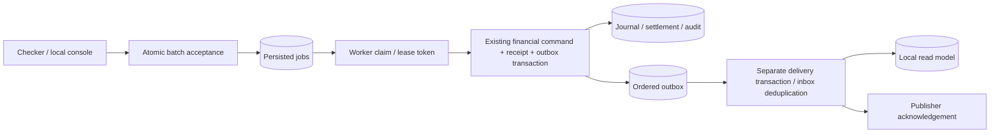

# V4 development — durable settlement operations

This branch adds a local multi-process settlement queue and a separately delivered observer view. It builds on the framework-depth branch; neither the prerequisite nor V4 is implicitly approved for release. There is no website deployment in this work.

## Start the lab

Install this source checkout with Python 3.9+ and `python -m pip install .`. Use a new database filename:

```sh
settlementlab --db /tmp/settlementlab-v4.db --business-date 2026-11-09 --port 8085
```

Open http://127.0.0.1:8085 and use the ordinary trade workbench to match and approve a synthetic shared-ledger trade. Open http://127.0.0.1:8085/operations, select Sam / Checker, select the approved trade and queue it. Acknowledged acceptance means the work was recorded; it does not move value or guarantee capacity.

In another terminal:

```sh
settlementlab-worker --db /tmp/settlementlab-v4.db --business-date 2026-11-09
# Bounded processing without a daemon:
settlementlab-worker --db /tmp/settlementlab-v4.db --business-date 2026-11-09 --once --mode process
settlementlab-worker --db /tmp/settlementlab-v4.db --business-date 2026-11-09 --once --mode deliver
```

The server and worker must use the same database. Simulated jobs retain their accepted clock mode/date: a worker with a different simulation date or system-clock mode fails the job for operator review. System-clock jobs may continue on a later actual UTC date; the financial service reevaluates eligibility under the trade's pinned calendar. Queue leases use real epoch time, never the simulated business date.

## Architecture



The observer is intentionally a local read model in the same SQLite database. It is not an external message broker, network custody system or distributed financial transaction. Separate Python processes can execute work and deliver events; SQLite remains the authority for financial state.

## Contracts

**Acceptance:** a batch contains 1–50 distinct approved shared-ledger trade IDs and expected versions. The checker identity is resolved by the server, not supplied in the JSON body. One transaction records the batch and every job. A repeated request key and matching normalized payload returns the accepted batch; changed payload conflicts. An invalid entry rolls back the entire batch. Only one active job per trade is allowed.

**Processing:** READY and due RETRY_WAIT work is claimed under BEGIN IMMEDIATE. The claim commits before financial execution. Each claim records an attempt, worker identity, unpredictable token and bounded expiry. Reclaiming expired work records the old attempt as EXPIRED and installs a new token. A stale worker cannot use the old token. No worker thread is started by the HTTP adapter.

**Atomic financial effect:** the worker calls the same financial command policy used by the synchronous workbench, using its already-owned transaction. State/version, checker, calendar and journal invariants are still checked. Financial writes, processing receipt, terminal job status and one outgoing financial event commit together. A crash before commit rolls them all back. A crash after commit leaves completed work outside the claimable queue. Uniqueness and receipts are scoped to job/generation; there is no universal exactly-once claim.

**Failure:** non-domain execution failures roll back and schedule capped exponential backoff (1, 2, 4… seconds, capped at 60), within a 1–10 attempt budget. Domain rejections require operator review. A financial capacity failure commits its ordinary FAILED transition, receipt and failure event, then places the job in DEAD_LETTER. The operator funds explicitly in the workbench, reviews current version and submits a reason before requeue. Requeue increments generation and retains previous attempts/receipts. It cannot requeue a completed trade, bypass approval or erase the old error history.

**Delivery:** outbox events are selected in sequence order, with at most one unfinished sequence per trade advancing. A delivery claim commits; a separate observer transaction inserts its unique event receipt and updates the projection; a later publisher transaction acknowledges delivery. A crash after observer commit but before acknowledgement causes redelivery. The durable inbox receipt prevents applying the observer effect twice. Explicit redelivery of a delivered event is available as a checker-only lab control and never reruns financial settlement.

**Blocked delivery:** failed or expired delivery attempts are bounded to five. Exhausted events become BLOCKED, remain visible and stop later events for the same trade from advancing. A checker can explicitly retry with a reason. Delivery claims/failures/retries and duplicate ignores are retained in the correlated operational timeline. Other trades can continue.

## Local HTTP surface

| Method | Path | Contract |
|---|---|---|
| GET | /operations | Local operations console |
| GET | /api/operations | Global totals and bounded job, attempt, outbox, observer and timeline history |
| POST | /api/operations/batches | Checker; Idempotency-Key; trades [{trade_id,version}], optional max_attempts |
| POST | /api/operations/jobs/{id}/requeue | Checker; current version and review reason |
| POST | /api/operations/events/{id}/retry | Checker; review reason for BLOCKED delivery |
| POST | /api/operations/events/{id}/redeliver | Checker; deliberately redeliver a DELIVERED event |

HTTP responses omit lease tokens. Cross-origin writes retain the existing rejection policy. There is no HTTP endpoint to launch, stop or fault a worker. Local CLI/database access is trusted operator access; demo personas are freely switchable and do not authenticate distinct humans.

## Reproduce the failure/recovery evidence

```sh
PYTHONPATH=src python -m scripts.durable_showcase
```

Open artifacts/durable-showcase/index.html. The script creates a disposable database, approves and accepts three synthetic trades, runs a real worker that exits 73 before commit, restarts processing after the lease expires, loses an acknowledgement after observer commit, and verifies deduplication. A fourth trade demonstrates capacity failure and explicit generation-2 recovery. The final report independently requires four financial settlements, 16 settlement journal lines, five execution receipts/events, five unique observer receipts and balanced reconciliation.

The script owns and cleans up its temporary database/processes. It does not stop any existing service, call a model or touch production data. JSON captures record each stage, command exit, source state and final checks. Checksums detect changed report files relative to the unsigned checksum file; they are not attestation.

Browser demonstration, with optional Playwright/Chromium tooling installed:

```sh
PYTHONPATH=src python tests/browser/durable_smoke.py
```

This starts an isolated loopback app, uses the actual operations UI and child worker processes, tests checker/auditor restrictions and narrow-screen layout, and saves screenshots, a silent WebM and journey JSON under artifacts/durable-browser/. Short pauses pace the recording; assertions, not elapsed animation, establish each outcome. No live AI is invoked.

## Explicit crash checkpoints

For disposable synthetic databases only, `--fault PHASE --once` exits the worker process with code 73 at after-claim, before-commit, after-commit, after-delivery-claim, before-observer-commit or after-consume. The selected process/delivery mode must contain that checkpoint. Leases are 0.1–300 seconds; the default is 30. Fault flags are never enabled by the server or a normal daemon command.

Tests exercise all six checkpoints with real child processes. They additionally cover transient retry budgets, expired-worker fencing, duplicate batch requests, atomic acceptance, blocked delivery, review, business-clock mismatch, financial date rejection and additive migration rollback.

## Upgrade and boundaries

Back up an existing database before starting this version. Schema version 5 adds operations tables atomically; core trade economics are not rewritten. Older application versions refuse the newer schema rather than silently downgrade it. If rollback is required, restore the pre-upgrade backup and its matching application version.

This is not authentication, durable storage hardware certification, a throughput SLA or protection against direct database tampering. Crashes at six tested boundaries are not proof against every possible machine/power-loss point. Multi-host deployment, external brokers, official market calendars and cross-database atomicity are outside this local lab. UI history is bounded (limits are returned explicitly); aggregate queue totals and oldest pending age cover the entire database. Financial audit correlation shows the most recent 100 events, not an unbounded forensic export.
