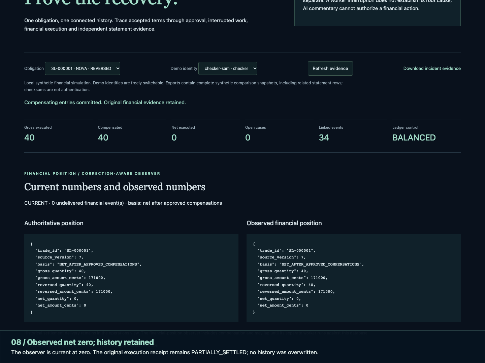

# V4.4 showcase package

Present SettlementLab through an actual incident rather than a list of features. The captioned, silent walkthrough takes about **2 minutes 20 seconds**. It records real browser actions, child-worker processes and a separate-process verifier using synthetic inputs. It makes no live AI call.



## Watch or reproduce

The recording is generated by the **browser** job in [Settlement assurance CI](https://github.com/kilicerdal/settlementlab/actions/workflows/assurance.yml). Open a successful run for the showcase-package branch/PR and download `browser-evidence`. Inside it, open `v44-walkthrough/walkthrough.webm`. GitHub may require sign-in to download CI artifacts, and artifacts expire under the repository retention policy. This is a CI artifact, not a permanent release attachment. Older V3 release videos remain explicitly historical.

To record locally from the repository root with an installed Python 3.13 interpreter:

```sh
python3.13 -m venv .venv
.venv/bin/python -m pip install 'playwright>=1.48,<2'
.venv/bin/python -m playwright install chromium
PYTHONPATH=src .venv/bin/python -m scripts.record_v44
```

Open `artifacts/v44-walkthrough/walkthrough.webm` in a browser or video player. The command requires localhost TCP access, creates its own temporary database/server, closes them and refuses to overwrite an existing output directory. Use `--output artifacts/v44-another-take` for a new take. Playwright/browser installation is recording tooling; the application itself has no required third-party runtime dependency.

The directory also contains the downloaded incident ZIP, external accepted plan, verifier output, worker logs, poster and `walkthrough.json`. That manifest records source commit, dirty-tree status, timestamps, scene offsets, actual duration and file hashes. A dirty working-tree capture is labeled as such and must not be described as exact released-source evidence. CI captures a clean checkout. The manifest is unsigned.

## Recorded sequence

| Scene | What to inspect |
| --- | --- |
| Queue | Approved synthetic obligation: 100 shares at $42.75; queued partial quantity 40. |
| Interruption | A real worker exits 73 at the deliberately injected after-claim checkpoint. |
| Recovery | A fresh worker recovers the expired lease; one execution slice remains. |
| Initial observation | Financial posting leads the observer; the position worker catches it up to 40. |
| Controlled correction | Maker requests and checker approves the inverse financial entries. |
| Lag after correction | Authoritative net is zero while observed net is still 40. |
| Delivery | Observed net becomes zero; the original historical settlement delivery remains. |
| Export and verify | A separate process verifies integrity and scoped economics against a plan outside the ZIP. |

Numerical expectations come from declared scenario inputs, not from the suspect journal. Batch identity comes from the command receipt. This illustrates independent expected values and separate-process verification; it is not independent human review or counterparty authentication. The recording alone does not prove the full regression suite passed.

## Present it in five minutes

Use the [interview speaking notes](INTERVIEW_WALKTHROUGH_V44.md), then open the [current architecture](ARCHITECTURE.md). Explain one deliberately defective balanced-but-wrong fixture and why conservation alone misses it. Link to [V4.4 measured controls and limits](V4_4.md) for release evidence, and [standalone assurance](STANDALONE_ASSURANCE.md) for reuse against the collateral service.

## Try it as a new user

Follow the [README quickstart](../README.md#start-the-v44-demonstration). It seeds the **completed** incident and serves it on 8086. It does not replay the video step by step. The separately installed empty workbench uses 8085. The [fresh-checkout report](FRESH_CHECKOUT_V44.md) records what was actually rehearsed and a local system-runtime failure.

The website is unchanged. This package adds no announcement, outside reviewer request or paid dependency. A permanent release-media upload can follow review of the PR; do not invent a download URL before the asset exists.
